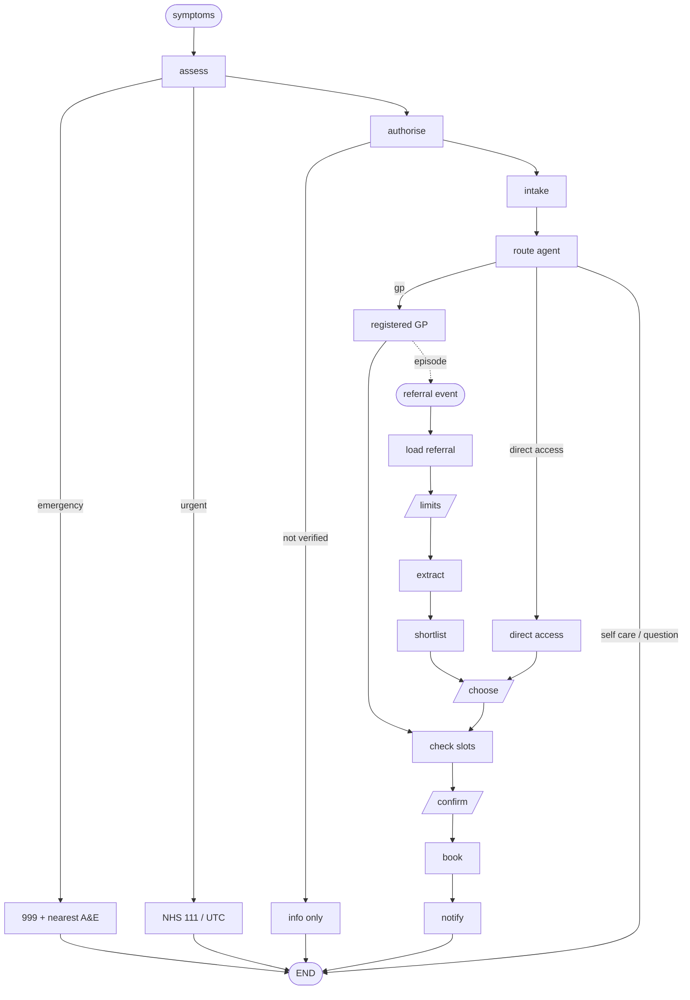

# UK CareRoute: agentic care navigation and booking

UK CareRoute takes a patient from "something is wrong" to a booked appointment
at the right place, with one confirmation from the patient. It covers two
journeys that meet in one booking flow:

- **Path A, symptoms**: find the right front door. Most problems don't need a
  GP: NHS Pharmacy First, sexual health clinics, NHS Talking Therapies and MSK
  physiotherapy all take patients directly.
- **Path B, referral**: when a GP refers through e-RS, help the patient choose
  where to be seen (NHS patient choice, or privately with insurance) and book it.

The design rule throughout: **the LLM handles language, code handles
decisions.** One agent picks the front door; every check on safety,
permission, money and booking is done in code.

> **Demo data, plus optional real pharmacies.** Every person, GP practice,
> clinic, booking, waiting time, price and insurer in `data/uk` is fictional.
> NHS numbers are in the 999 range NHS England reserves for testing. If you
> import NHS open data (below), real pharmacy names and addresses appear
> outside Leeds; they are never bookable, and what the registers don't say
> (opening hours, Pharmacy First participation) is shown as unknown.
> This is not an NHS service.

## Real pharmacies from NHS open data (optional)

```bash
python -m scripts.import_nhs_directory --pharmacies path/to/pharmacies.csv --postcodes-io
```

This writes `data/uk/nhs/directory.json` (about 4 MB for England) from the
NHSBSA pharmacy list or an ODS export, with coordinates from postcodes.io or
the ONS Postcode Directory. All are free under the Open Government Licence;
the page shows the attribution. With the file present the directory runs in
`mixed` mode: Leeds stays the scripted demo, and anywhere else in England finds
real pharmacies. See [docs/demo-runbook.md](docs/demo-runbook.md) for where
to download the files and how to run a stakeholder demo.

## Run it in two minutes (no API key needed)

```bash
pip install -r requirements.txt
cp .env.example .env
uvicorn --factory careroute.api.app:create_app --reload
# open http://localhost:8000
```

With no `OPENAI_API_KEY` it runs in **offline mode**: deterministic rules
stand in for the three language steps and a scripted model stands in for the
route agent, so the demo works on a train. Add a key to use gpt-4o-mini.

## A demo script (about 10 minutes)

Pick the user in the top-right corner. The dark panel on the right shows each
step as it runs, tagged **Code** or **Model**.

1. **Priya**: "I've had burning when I pee since yesterday". Pharmacy First,
   eligibility checked in code (women 16 to 64), nearest pharmacies, book a
   consultation, one confirmation, a text with no health details.
2. **Tom**: the same message. Not eligible for that pathway (male), so the
   route is his GP. His practice offers appointments online (IM1), so there is
   nothing to choose: straight to times.
3. **Priya**: "my son has earache". She has two children on her record, so it
   asks which. "Arjun has earache": proxy access from the GP record, and the
   child's age decides eligibility.
4. **Priya**: "Maya wants an STI test". A parent can't book a teenager's
   confidential service. Switch to **Maya**: she can, and Priya's bookings
   list never shows it.
5. **Tom**: "my friend Sam has a bad back, can you book physio for him".
   Typing a relationship grants nothing: Tom gets a one-time consent link.
   Switch to **Sam**, open the link, approve. Switch back: Tom books, once.
6. **Priya**: "headaches every morning for three weeks". Her practice uses
   total triage, so CareRoute sends her description to its online
   consultation form. Then in Demo controls, **GP refers**: an e-RS referral
   arrives carrying the same episode, and Path B opens with that context.
7. **Send referral** (Tom, orthopaedics): "under 8 weeks, within 20 km".
   Filtering, widening and ranking all happen in code. Try "under 2 weeks,
   within 3 km": nothing fits, so each option shows which limit it bends.
8. **Send referral** (Tom, dermatology, private): the insurer, not the model,
   says he pays his £100 excess; pre-authorisation and payment use the same
   idempotency key as the booking.
9. Set **Next booking attempt: time is taken** and confirm: fresh times, no
   double booking. Set **booking system is down**: an honest "nothing has been
   charged; safe to try again".
10. "Crushing chest pain and I'm sweating", even signed out: 999 first,
    before login, with no model call at all.

## The graph



Design notes, the mapping of each step to real UK systems (NHS login, PDS,
IM1/GP Connect, e-RS, BaRS, GOV.UK Notify), and the assurance a real
deployment needs are in [docs/uk-design.md](docs/uk-design.md).

## Why it is safe by construction

- **It can't invent a provider.** The route agent finishes with
  `recommend(care_route, provider_ids, reason)`. `RecommendationGuard` checks
  every id was returned by a search in this conversation and fits the route;
  names, addresses, times and prices are rendered from records
  (`careroute/uk/render.py`). Prose without a recommendation never reaches
  the patient.
- **Emergency checks never wait.** Red-flag rules run before login and before
  any model call. The model can escalate a level; it can never downgrade a rule.
- **Permission comes from records, not words.** Only `authorise` (Path A) and
  `load_referral` (from e-RS) set `patient_id`. Proxy links come from the GP
  record; friends approve a one-time link while signed in as themselves.
  Permission is re-checked at booking time.
- **Money is exact.** Prices and the patient's share come from the insurer, as
  `Decimal` pence. The model only extracts the limit the patient stated, and
  code converts units (miles, months).
- **Exactly once.** Every booking, payment, pre-authorisation and text uses an
  idempotency key derived from the thread, patient, option and slot.
- **An outage is never "nothing available".** A booking error says so, and a
  directory problem is reported as a problem.
- **Confidential stays confidential.** A parent can't book, see, or find in the
  audit log a 13+ child's sexual health or talking therapies care.
- **Everything done on someone's behalf is logged** and visible to them
  (`GET /audit`); adults are texted when someone books for them.

## Project layout

```
careroute/uk/              UK CareRoute (start here)
  graph.py                 the journey graph: nodes, edges, interrupts
  route_agent.py           the one agent + its tools + RecommendationGuard
  llm.py                   subject, triage, preferences (OpenAI | offline)
  offline_model.py         scripted route model for offline mode and tests
  triage_rules.py          red flags (engineer's draft: needs clinical sign-off)
  pharmacy_first.py        the 7 conditions and their eligibility bands
  authority.py             self / proxy / consent, decided in code
  identity.py              NHS login ID-token verification, demo login
  integrations.py          e-RS, GP, provider booking, insurer, payments, SMS
  records.py, directory.py, geo.py, store.py, render.py, state.py
  service.py, api.py       one HTTP call end to end; the routes
careroute/                 shared foundations from the original CareRoute:
                           config, container (DI), checkpointer, Redis, rate
                           limits, OSRM routing, Nominatim, PostGIS, legacy agent
data/uk/                   fictional demo data (python -m scripts.make_uk_demo_data)
data/uk/nhs/               optional real pharmacies (python -m scripts.import_nhs_directory)
web/index.html             the UK demo page; web/legacy.html the original UI
docs/                      design notes; the original README
tests/test_uk_*.py         UK tests (units, journeys, HTTP, NHS login, Notify)
```

## API

| Endpoint | Purpose |
|---|---|
| `POST /chat` | New message on a thread. JSON, or SSE with `?stream=1`: `status` lines before each piece of work, `step`/`progress` after it, then the `result` |
| `POST /chat/resume` | Answer a paused interrupt: `{option_id}`, `{text}` (limits), `{slot_id, consent}` |
| `GET /chat/{thread_id}` | History and current pause, for reloads and other devices |
| `POST /referrals/events` | A referral arrives (`{ubrn}`, `X-Event-Key`): starts a Path B thread, idempotently |
| `GET /directory` | Where provider data comes from: mode, counts, coverage, attribution |
| `GET /me`, `/inbox`, `/bookings`, `/audit` | Who I can act for, referrals waiting, bookings, actions taken for me |
| `GET/POST /consents/{token}[/approve\|/decline]` | One-time consent links |
| `/demo/*` | User list, simulated referrals and GP outcomes, fault switch, SMS outbox |
| `/legacy/care`, `/legacy/chat` | The original single-agent CareRoute |

Identity: `X-Demo-User: <NHS number>` in demo mode; `Authorization: Bearer
<NHS login ID token>` with `NHS_LOGIN_MODE=oidc`.

## Configuration

Everything is in `.env.example`, read once by `careroute/config.py`. The
UK-specific settings:

| Variable | Default | Meaning |
|---|---|---|
| `CAREROUTE_LLM` | `openai` if a key is set, else `offline` | Which language steps and route model |
| `NHS_LOGIN_MODE` | `demo` | `oidc` verifies NHS login tokens (needs `NHS_LOGIN_CLIENT_ID`) |
| `CAREROUTE_DEMO_TOOLS` | `1` | `/demo/*` routes; turn off anywhere real people could reach |
| `CAREROUTE_REFERRAL_EVENT_KEY` | empty | Shared secret for referral events (required when demo tools are off) |
| `CAREROUTE_PUBLIC_BASE_URL` | `http://localhost:8000` | Base of consent links |
| `GOVUK_NOTIFY_API_KEY`, `GOVUK_NOTIFY_SMS_TEMPLATE_ID` | empty | Real SMS; empty uses the demo outbox |
| `CAREROUTE_GEOCODE_COUNTRIES` | `gb` | Nominatim country filter |
| `CAREROUTE_UK_DIRECTORY` | `auto` | `demo`, `nhs` or `mixed`; `auto` is `mixed` when `data/uk/nhs/directory.json` exists, else `demo` |

## Tests

```bash
pip install -r requirements-dev.txt  # the app's requirements plus pytest
python -m pytest                     # everything, offline, no key
python -m pytest tests/test_uk_*.py  # just UK CareRoute
```

| File | What it pins down |
|---|---|
| `test_uk_units.py` | NHS number check digits, Pharmacy First bands, red-flag rules, unit conversion, insurer maths, SMS privacy, the recommendation guard |
| `test_uk_journey.py` | Whole journeys: 999 with no model call, escalation never downgraded, proxy and consent, teen confidentiality, invented ids rejected, exactly-once booking, slot taken, honest errors, resume on another replica, GP episode to referral, limits and near misses, private cost |
| `test_uk_nhs_data.py` | The NHS open data importer (filters, postcodes, attribution), directory modes and grid search, real pharmacies never booked, "nothing nearby" said plainly, answers to replaced cards refused |
| `test_uk_api.py` | HTTP: identity, thread ownership (404 not 403), SSE, confidential bookings hidden, inbox, consent links, event keys, NHS login token checks (audience, P9, expiry, key), GOV.UK Notify auth and idempotency |

With `REDIS_URL` and `DATABASE_URL` set, the same tests run against Redis and
the Postgres checkpointer (CI does both).

## Running replicas, maps and deployment

These work as in the original project (see [docs/legacy-README.md](docs/legacy-README.md)):

- `docker compose up --build --scale app=3` runs stateless replicas behind
  nginx, with Redis and Postgres. Journey state lives in the Postgres
  checkpointer and Redis, so a paused booking resumes on any replica.
- Self-hosted maps now default to **West Yorkshire** (`infra/geo`): the
  `geo-fetch`, `geo-import` and `osrm-prep` jobs build OSRM and Nominatim for
  real drive times. Without them, distances are labelled straight-line.
- CI (`.github/workflows/deploy.yml`) always runs the tests. Build and deploy
  to Azure Container Apps only run when the repository variable
  `DEPLOY_ENABLED` is `true` and the `AZURE_*` secrets are set.

## What is real and what is simulated

Real: the graph, interrupts and resumes, the agent and its guard, triage
rules, eligibility, authority checks, idempotency, ranking and limit logic,
the NHS login token verifier and the GOV.UK Notify client, streaming, shared
state across replicas.

Simulated (`careroute/uk/integrations.py`, behind small interfaces): e-RS, GP
systems, provider booking, insurer and payments, and the demo records. Each
demo class behaves like its real API where the design depends on it
(idempotency keys, 409 conflicts, 5xx failures).

## Next steps

1. Clinically validated triage: clinicians write and sign off the red-flag
   rules and a triage golden set; evaluate the model's escalations against it.
2. Sandbox integrations: NHS login sandpit, PDS, e-RS and GP Connect sandboxes
   from the NHS developer portal, replacing the demo classes one at a time.
3. Records of truth in Postgres: consent grants, the audit log and the booking
   ledger move from Redis to tables with retention rules.
4. Pre-approval for free NHS bookings ("just book it if it fits").
5. Cancellation watching as a scheduled worker that resumes a paused thread.
6. Long-term preferences with consent, visible and deletable by the patient.
