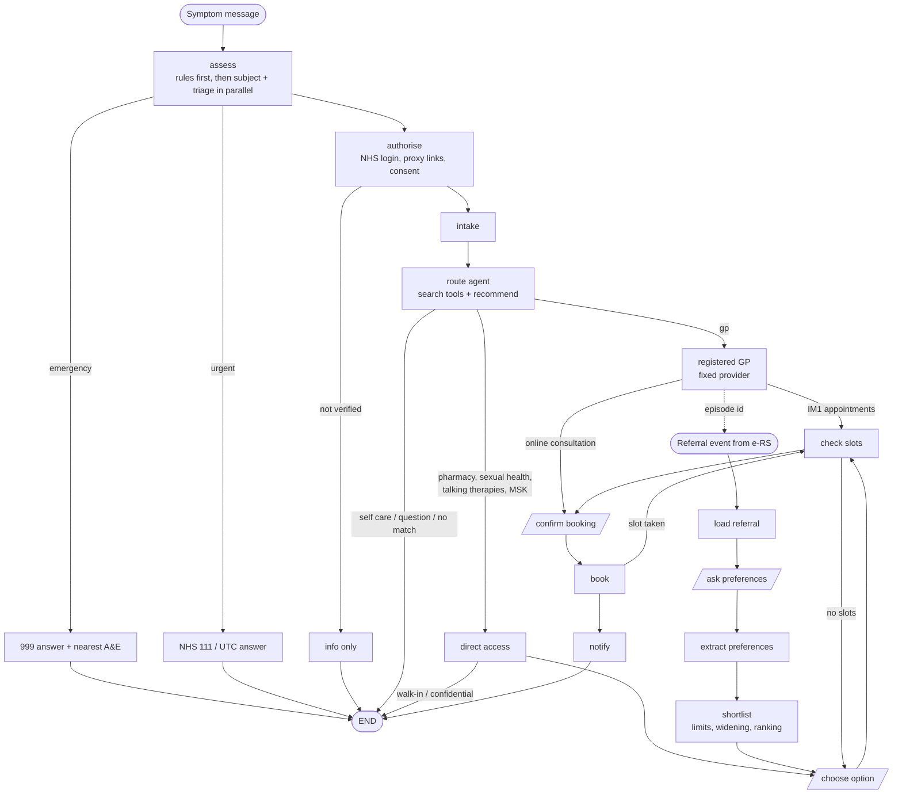

# UK CareRoute: design notes

The patient's journey, the graph that implements it, and how each step maps
to the real UK systems it would use in production.

## One journey, two threads

In the NHS a referral is not a separate front door: it is what follows a GP
consultation. So the graph models the GP branch of Path A and the referral of
Path B as one **episode** that spans two threads:

Slanted boxes are interrupts: the patient decides. Only `assess`,
`route_agent` and `extract_preferences` use a model.

## What changed from the first design

| Before | After | Why |
|---|---|---|
| The GP branch went through `choose_option` | It goes straight to slots (IM1) or to the practice's online consultation form | A patient is registered at one practice; there is nothing to choose. Many practices run total triage. |
| Path B was a separate entry with no link to Path A | A GP request records an episode; the e-RS referral carries the id; Path B opens with that context | A referral is the continuation of a GP consultation |
| Direct access and referral options reached booking by different edges | Both produce one ranked options list for `choose_option` | Same decision for the patient: where to go |
| The route agent wrote a provider list; a regex guard checked it | The agent calls `recommend(route, provider_ids, reason)`; code checks every id against search results and renders names from records | An invented provider is impossible, not just blocked |
| Urgent cases shared the 999 exit | Separate NHS 111 / urgent treatment centre exit | Most urgent problems are not emergencies |

## Mapping to real UK systems

| Step | Demo implementation | Production integration |
|---|---|---|
| Identity | `X-Demo-User` header | NHS login (OIDC, P9), `NhsLoginIdentity` verifies ID tokens |
| Proxy access | `linked_profiles` in demo records | GP record proxy access (linked profiles in the NHS App) via the GP system |
| Patient record | `data/uk/patients.json` | PDS FHIR API (demographics, registered practice) |
| Service directory | `data/uk/services.json` | NHS Service Search API / Directory of Services, imported into PostGIS |
| Pharmacy First | eligibility table in code | same table, kept in step with the NHS England specification; referral via BaRS where a pharmacy accepts bookings |
| GP appointments | `DemoGpSystem` | IM1 patient-facing services (EMIS Web, SystmOne) or GP Connect Appointment Management |
| GP online consultation | `DemoGpSystem.submit_online_consultation` | the practice's online consultation supplier |
| Referrals | `DemoErs` | NHS e-Referral Service API (UBRN, services with waiting times, booking) |
| Urgent handoff | 111 / UTC message | NHS 111 with a BaRS booking where available |
| Insurance | `DemoInsurer` | insurer eligibility and pre-authorisation APIs |
| SMS | demo outbox | GOV.UK Notify (implemented) or NHS Notify |

## Assurance a real deployment would need

- **Clinical safety**: DCB0129 (manufacturer) and DCB0160 (deploying organisation),
  with a clinical safety officer, hazard log and safety case. The red-flag rules
  in `careroute/uk/triage_rules.py` are an engineer's draft and must be written
  and signed off by clinicians.
- **Medical device status**: software that triages symptoms is likely to be a
  medical device under MHRA rules; that decides the regulatory route.
- **DTAC** (Digital Technology Assessment Criteria), DSPT, and a DPIA.
- **Integration onboarding**: IM1 pairing per GP system supplier, NHS login
  onboarding, e-RS API access, each with its own assurance.
